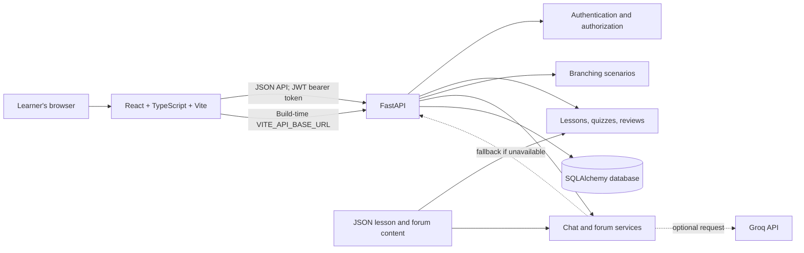

# BodyLingo

**Conversations. People. You.**

## Idea

BodyLingo is a communication-learning app that helps people notice conversational cues, consider context, and practice thoughtful responses. Its penguin companion, Pip, guides learners through short lessons and interactive practice.

## Problem statement

People often interpret body language, tone, or conversational behavior as if each cue has one fixed meaning. That can lead to misunderstandings, exclusion, or pressure to guess what someone else intends. Many people also need practical ways to respond when a conversation or emotional state feels difficult, but may not have a low-pressure place to learn and practice.

## Solution

BodyLingo offers short, accessible learning experiences that treat cues as possibilities rather than conclusions. Learners can build observation skills, try branching conversation scenarios, revisit knowledge checks over time, and explore practical response exercises. The app encourages respectful clarification and personal choice; it does not claim to read minds or diagnose people.

## DEMO LINK:
https://drive.google.com/file/d/1UIXiljUmZ4sxr3XS9VhfiVblF7whoK-V/view?usp=sharing

## Tech stack

| Area | Technology |
| --- | --- |
| Frontend | React 19, TypeScript, Vite, CSS, Lucide icons |
| API | Python, FastAPI, Pydantic |
| Persistence | SQLAlchemy, Alembic migrations, SQLite locally or PostgreSQL when configured |
| Authentication | Argon2 password hashing via `pwdlib`, JWT bearer tokens via PyJWT |
| Optional AI | Groq API for chatbot responses and forum tagging, with deterministic fallbacks |
| Content | JSON lesson and forum seed data; scenario definitions and learner activity stored in the database |

## User flow

1. A learner registers or signs in. The API returns a JWT access token; the browser stores it and includes it in authenticated API requests.
2. The learner opens **Observations** to browse recommended lessons, read a cue and its context, and answer knowledge-check questions.
3. Answers and lesson completion are saved. Incorrect answers can be scheduled for review, with later correct answers spacing reviews further apart.
4. In **Responses**, the learner explores practical exercises for difficult states. These are educational self-help techniques, not personalized clinical care.
5. In **Scenarios**, the learner chooses responses in branching conversations and receives feedback as the scenario progresses.
6. In **Chatbot**, the learner can ask questions related to BodyLingo lessons and scenarios. In **Forum**, they can search and filter fictional example discussions.
7. Progress, scenario sessions, and chat conversations are associated with the signed-in account.

## Architecture



The frontend and API are separate applications. FastAPI routers expose authentication, lesson, learning, scenario, chat, and forum endpoints. Services contain the corresponding business logic. SQLAlchemy models define persisted data; Alembic applies schema migrations. The API can use SQLite for local development or PostgreSQL for a hosted deployment. Groq is optional: chat and forum features have deterministic fallback behavior when it is not configured or unavailable.

## Run locally

### Requirements

- Python 3.10 or newer
- Node.js 20.19+ or 22.12+
- npm (included with Node.js)

### 1. Set up the backend

From the repository root, create and activate a virtual environment, then install the backend dependencies:

```bash
cd backend
python -m venv .venv
```

macOS/Linux:

```bash
source .venv/bin/activate
```

Windows PowerShell:

```powershell
.venv\Scripts\Activate.ps1
```

Then, on either platform:

```bash
pip install -r requirements.txt
```

Create `backend/.env` (or copy `backend/.env.example`) and set a development signing key:

```dotenv
APP_ENV=development
JWT_SECRET_KEY=replace-with-a-long-random-secret
JWT_ACCESS_TOKEN_EXPIRE_MINUTES=30
DATABASE_URL=
ENABLE_DEMO_PREMIUM=0
GROQ_API_KEY=
GROQ_MODEL=llama-3.3-70b-versatile
CORS_ORIGINS=http://localhost:5173,http://127.0.0.1:5173
```

Generate a random key with `openssl rand -hex 32`. Keep `.env` private and out of version control. An empty `DATABASE_URL` uses local SQLite. Apply migrations and start the API from the `backend/` directory:

```bash
alembic upgrade head
uvicorn main:app --reload --port 8000
```

The API is at <http://localhost:8000>; interactive docs are at <http://localhost:8000/docs>, and the health check is <http://localhost:8000/health>.

### 2. Set up the frontend

In a second terminal, from the repository root:

```bash
cd frontend
npm install
```

Create `frontend/.env`:

```dotenv
VITE_API_BASE_URL=http://localhost:8000
```

Start the frontend:

```bash
npm run dev
```

Open the local URL printed by Vite (usually <http://localhost:5173>). The frontend reads `VITE_API_BASE_URL` when it starts/builds; restart the dev server after changing it.

### Optional checks

Run the frontend tests from `frontend/`:

```bash
npm test
```

Backend tests are in the root `tests/` directory. From the repository root, activate the backend virtual environment and run:

```bash
python -m pytest
```

## Deployment

One straightforward setup is **Render** for FastAPI and PostgreSQL, and **Vercel** for the static Vite frontend.

### Backend and database (Render)

1. Create a PostgreSQL database and a web service connected to this repository and the desired branch.
2. Set the web service root directory to `backend`.
3. Configure the build command as `pip install -r requirements.txt` and the start command as:

   ```bash
   uvicorn main:app --host 0.0.0.0 --port $PORT
   ```

4. Set the health check path to `/health`.
5. Configure these service environment variables:

   ```text
   APP_ENV=production
   DATABASE_URL=postgresql+psycopg://<user>:<password>@<host>:<port>/<database>
   JWT_SECRET_KEY=<new-random-secret>
   JWT_ACCESS_TOKEN_EXPIRE_MINUTES=30
   ENABLE_DEMO_PREMIUM=0
   CORS_ORIGINS=https://<your-frontend-domain>
   ```

   Use the database provider's private/internal connection string when the service shares its network. The backend requirements install the `psycopg` driver, so its URL uses `postgresql+psycopg://`. Add `GROQ_API_KEY` only if enabling the optional Groq integration. Keep secrets in the hosting provider's environment settings, never in Git.

6. Apply migrations with `alembic upgrade head` before serving traffic. On a hosting plan with a pre-deploy command, configure it to run from the `backend` service root. If the plan does not provide a shell or pre-deploy command, run Alembic from a trusted machine using the database's external URL and the backend dependencies.
7. Confirm `https://<backend-domain>/health` returns `{"status":"ok"}`.

### Frontend (Vercel)

1. Import the same repository and branch into Vercel; set the project root directory to `frontend`.
2. Use `npm run build` as the build command and `dist` as the output directory.
3. Set the production environment variable:

   ```text
   VITE_API_BASE_URL=https://<backend-domain>
   ```

4. Deploy. Copy the final frontend origin (scheme and hostname, no trailing slash) into the backend's `CORS_ORIGINS`, then redeploy the backend if needed.
5. Open the frontend and verify registration/sign-in, lesson loading, scenario progress, and API requests. Check the browser console and backend logs if a request fails.

Free hosting tiers may sleep when idle or have temporary/expiring database storage. Review the providers' current limits before using a free deployment for persistent user data.

## Disclaimer

BodyLingo is an educational communication-practice tool, not a medical or mental-health service. Its lessons, exercises, chatbot responses, and scenarios are general information and may not fit every person or situation. They do not provide diagnosis, therapy, crisis support, or a substitute for advice from a qualified professional. AI-generated responses can be inaccurate; use judgment and verify important information. If you may be in immediate danger or need urgent support, contact local emergency services or a qualified crisis-support service.
